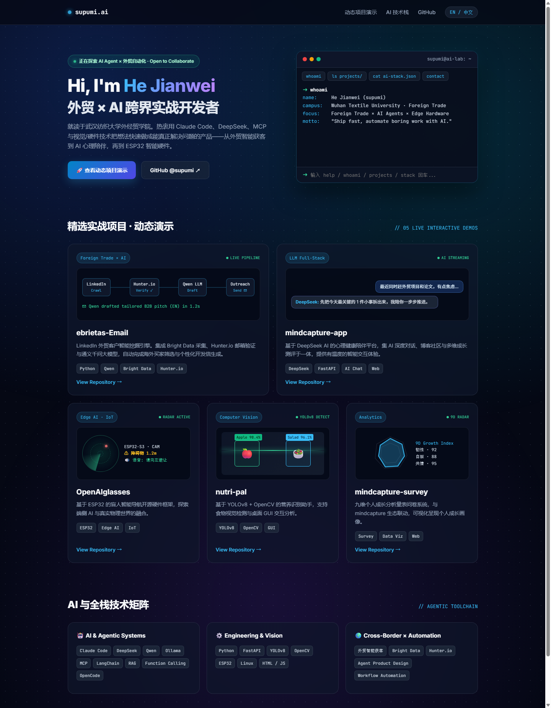

<div align="center">

<!-- 专属自托管动态科技横幅（永不裂图） -->


<!-- 动态打字机标语 -->
<a href="https://supumi.github.io">
  
</a>

<br/>

<!-- 个人官网与核心徽章 -->
<p>
  <a href="https://supumi.github.io" target="_blank">
    
  </a>
  
  
  
</p>

</div>

---

### `>_` Whoami

```yaml
name: He Jianwei (supumi)
affiliation: School of Foreign Economics and Trade, Wuhan Textile University
role: Foreign Trade × AI Builder · Full-Stack & Agentic Workflow Explorer
mission:
  - 用 AI Agent 与自动化重塑外贸获客、信息检索与日常办公效率
  - 从「调 API」走向「端到端交付」：软件工具 / 视觉算法 / ESP32 硬件全栈实验
currently_exploring:
  - Model Context Protocol (MCP) & Multi-Agent Orchestration
  - RAG / Function Calling / Local LLM Deployment (Ollama)
  - AI-Native Product Design & Rapid Prototyping
```

---

### 🚀 Featured Projects · 精选实战项目

<table>
  <tr>
    <td width="50%" valign="top">
      <h3>🌐 <a href="https://github.com/supumi/ebrietas-Email">ebrietas-Email</a></h3>
      <p><b>外贸 × AI 智能获客引擎</b></p>
      <p>结合 LinkedIn 数据、Bright Data、Hunter.io 与通义千问大模型，自动化完成海外潜在客户挖掘、邮箱验证与精准开发信生成。</p>
      <p>
        <code>Python</code> <code>Qwen</code> <code>Bright Data</code> <code>Hunter.io</code>
      </p>
    </td>
    <td width="50%" valign="top">
      <h3>💙 <a href="https://github.com/supumi/mindcapture-app">mindcapture-app</a></h3>
      <p><b>DeepSeek AI 心理健康陪伴平台</b></p>
      <p>集 AI 深度共情对话、博客社区与多维成长测评于一体的全栈 AI Web 应用，配套 <a href="https://github.com/supumi/mindcapture-survey">mindcapture-survey</a> 九维量表系统。</p>
      <p>
        <code>DeepSeek</code> <code>FastAPI</code> <code>AI Chat</code> <code>Full-Stack</code>
      </p>
    </td>
  </tr>
  <tr>
    <td width="50%" valign="top">
      <h3>🦯 <a href="https://github.com/supumi/OpenAIglasses_for_Navigation">OpenAIglasses_for_Navigation</a></h3>
      <p><b>ESP32 智能盲人导航开源框架</b></p>
      <p>软硬件结合的边缘端 AI 探索，基于 ESP32 打造的智能眼镜导航辅助框架，连接真实物理世界与 AI 感知能力。</p>
      <p>
        <code>ESP32</code> <code>Edge AI</code> <code>Hardware</code> <code>Open Source</code>
      </p>
    </td>
    <td width="50%" valign="top">
      <h3>🥗 <a href="https://github.com/supumi/nutri-pal">nutri-pal</a></h3>
      <p><b>YOLOv8 智能营养识别助手</b></p>
      <p>基于 YOLOv8 目标检测与 OpenCV 图像处理构建的桌面端食物识别与营养分析工具，带完整可视化 GUI。</p>
      <p>
        <code>YOLOv8</code> <code>OpenCV</code> <code>Python</code> <code>GUI</code>
      </p>
    </td>
  </tr>
</table>

---

### ⚡ AI & Engineering Stack · 技术雷达

<div align="center">

**🤖 AI Agents & LLM Ecosystem**
<br/>


<br/><br/>

**🛠️ Engineering, Vision & Hardware**
<br/>


</div>

---

### 🌐 Interactive Portfolio · 个人 AI 实验室官网

<div align="center">
  <a href="https://supumi.github.io" target="_blank">
    
  </a>
  <br/>
  <sub>👆 点击上方预览图访问 <a href="https://supumi.github.io"><b>https://supumi.github.io</b></a>（含交互式 AI 终端、5 大项目动态演示与中英双语切换）</sub>
</div>

---

### 📊 Tech Language Distribution · 技术语言分布

<div align="center">
  
</div>

<div align="center">
  <sub>⚡ Crafted with AI-Native Mindset · Visit <a href="https://supumi.github.io">supumi.github.io</a> for Live Interactive Project Demos</sub>
</div>
